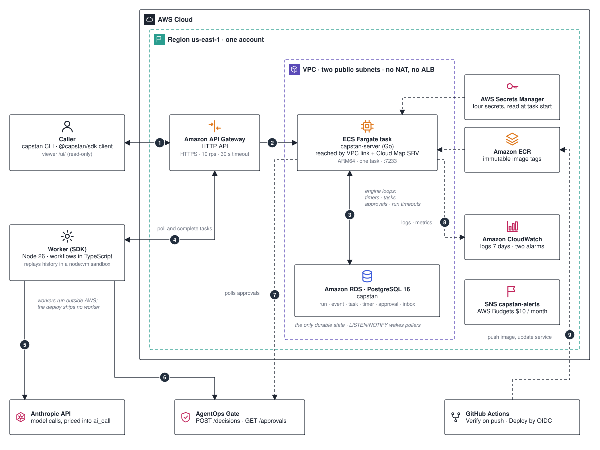

# Architecture

Capstan is a durable execution engine for agent work. Workflows are ordinary TypeScript. A Go server backed by PostgreSQL records what each workflow decided, and a worker replays that record to continue the workflow after a crash.

This page is the map: which parts exist, where they run, and the path one run takes through them. The numbers on the diagram match the list below. For the reasoning behind each choice read [`decisions.md`](./decisions.md); for the measured proofs read [`evidence/README.md`](./evidence/README.md).

## The path of one run

1. **Caller → Amazon API Gateway.** The `capstan` CLI, the `@capstan/sdk` client or the viewer calls `ClientService` over Connect with `Authorization: Bearer <key>`. The HTTP API only routes `GET /healthz`, `GET /readyz` and `POST /capstan.v1.{ClientService,WorkerService}/{method}`, throttled at 10 requests per second with a burst of 20 and a 30 s timeout.
2. **API Gateway → the server task.** A VPC link resolves the task through Cloud Map (`capstan.internal`, service `server`) and reaches `capstan-server` on port 7233. There is one task, ARM64, 0.25 vCPU and 512 MiB.
3. **Server ↔ PostgreSQL.** `StartRun` runs one transaction: insert the `run`, append `RunStarted` to `event`, insert a workflow `task`, then `pg_notify('capstan_tasks')` so pollers wake at once. Every later decision is the same shape: one transaction, append-only events, a token checked against `run.last_event_id` so a stale worker is rejected. Four server loops (`timers`, `tasks`, `approvals`, `run_timeouts`) also write here and nowhere else.
4. **Worker ↔ server.** The worker long-polls `PollWorkflowTask` (20 s). The server claims the task with `SKIP LOCKED`, appends `TaskScheduled` and `TaskStarted`, and returns the full history plus a task token. The worker replays the history from line one inside a `node:vm` sandbox; the workflow code emits commands (`ScheduleActivity`, `StartTimer`, `RequestApproval`, …) which go back in `CompleteWorkflowTask`. Activities are polled the same way and run in normal Node under the key `<run_id>/<seq>`; their results return through `CompleteActivityTask` or `HeartbeatActivityTask`. Steps 3 and 4 repeat until the run completes.
5. **Worker → Anthropic API.** The `capstan.model` built-in calls the model. The server brackets each call with `ReserveAICall` and `FinishAICall`, prices the usage into `ai_call`, and enforces `CAPSTAN_DAILY_CAP_USD` (default 2.00, counted on the America/Toronto day).
6. **Worker → AgentOps Gate.** The `capstan.gate.decide` built-in posts the proposed action to the gate's `POST /decisions` with `X-API-Key` and an `Idempotency-Key`.
7. **Server → AgentOps Gate (polling).** When the gate answers `REQUIRE_APPROVAL`, the `approvals` loop polls `GET /approvals/{id}` outside any transaction, backing off from 15 s to 5 min, and appends `ApprovalResolved` when a human decides. A waiting run holds no task, no lease and no worker. Humans can also resolve through `ResolveApproval` on the client API.
8. **Server → Amazon CloudWatch.** Logs go to `/capstan/server` (7 days). A Lambda publishes `Capstan/Service RunningTaskCount`; the alarms `capstan-http-5xx-rate` and `capstan-no-running-task` notify the `capstan-alerts` SNS topic. A $10 monthly budget caps the account.
9. **GitHub Actions → Amazon ECR and ECS.** `Verify` runs on every push and pull request against a PostgreSQL service container. `Deploy` is manual, `main` only, and assumes the `capstan-github-deploy` role through OIDC. The role can deploy the workload stack only; it cannot destroy anything or touch network and identity.

The run ends with `RunCompleted`, `run.status = COMPLETED` and a `NotifyRunClosed`, which the caller observes through `DescribeRun`, `AwaitRun`, `GetHistory` or the viewer at `/ui/`.

## Recovery

The crash proof follows the same arrows:

1. The server dies (locally `SIGKILL`; on AWS `aws ecs stop-task`). The worker keeps polling and logs the failures.
2. A replacement server starts against the same database with `CAPSTAN_MIGRATE=true`; `/readyz` runs `select 1`.
3. The `tasks` loop returns tasks whose `leased_until` has passed to the pool; the `timers` loop fires overdue timers.
4. The worker polls, receives the full history and replays it. Recorded steps resolve from history; the unfinished step retries under its original key. Retries are not history events.
5. The run completes with a byte-identical pre-crash prefix, and `capstan replay` prints `OK`.

A killed worker is the simpler case: its lease expires, the activity retries with the same key, and the destination deduplicates.

## Components

| Component | Responsibility | Technology | Where to look |
| --- | --- | --- | --- |
| Caller | Start, inspect, signal, cancel, approve and list runs | `capstan` CLI, `@capstan/sdk/client`, static viewer at `/ui/` | `sdk/bin/capstan.mjs`, `sdk/src/cli/`, `sdk/src/client/`, `internal/server/ui/` |
| `capstan-server` | `ClientService` and `WorkerService`, long-poll task matching, the four loops, migrations | Go, connect-go, pgx, h2c and HTTP/1.1, distroless ARM64 image | `cmd/capstan-server/`, `internal/server/`, `internal/engine/`, `internal/auth/`, `Dockerfile` |
| PostgreSQL | The only durable state: `run`, `event`, `inbox`, `task`, `timer`, `approval`, `signal_request`, `ai_call` | PostgreSQL 16 (`postgres:16-alpine` locally, RDS `db.t4g.micro` on AWS) | `internal/store/pgstore/`, `migrations/` |
| Worker | Polls tasks, replays workflows in a sandbox, runs activities and built-ins | Node 26, TypeScript, connect-node, esbuild, zod | `sdk/src/worker/`, `sdk/src/replay/`, `sdk/src/sandbox/`, `sdk/src/workflow/` |
| Anthropic API | Model calls priced by the server | `@anthropic-ai/sdk`, `ANTHROPIC_API_KEY` on the worker only | `sdk/src/worker/builtins/model.ts`, `internal/engine/ledger.go` |
| AgentOps Gate | Policy decision and human approval for proposed actions | HTTP, `X-API-Key` | `sdk/src/worker/builtins/gate.ts`, `internal/gate/client.go` |
| AWS workload | HTTP API, VPC link, Cloud Map, one Fargate task, RDS, secrets, logs, alarms, budget | CDK, five stacks | `infra/lib/`, `infra/runtime/task-count.py` |
| CI/CD | Verify on push, manual deploy by OIDC | GitHub Actions | `.github/workflows/`, `.github/scripts/deploy.sh` |
| Fault lab and load driver | Seeded fault injection, mutation runner, PostgreSQL campaign, load generator | Go `testing/synctest` | `internal/lab/`, `cmd/capstan-lab`, `cmd/capstan-load`, `conformance/` |

## Boundaries

- **Trust.** Every RPC and `/metrics` needs a Bearer key that the server checks against SHA-256 hashes in `CAPSTAN_API_KEY_HASHES`. `/healthz`, `/readyz` and the viewer's static files are open. The sandbox exists for replay determinism, not as a security boundary: workers run trusted code. Payloads are opaque to the server and visible to any key holder.
- **Secrets.** The worker holds the Capstan key, `ANTHROPIC_API_KEY` and the gate key. The server holds the database URL, the key hashes and the gate key for polling. On AWS these live in four Secrets Manager entries read at task start.
- **Network.** One account, `us-east-1`, one VPC with two public subnets and no NAT, ALB or VPC endpoints. The task security group accepts 7233 only from the VPC link; the RDS group accepts 5432 only from the task. The task has a public IP for outbound 443 (ECR, Secrets Manager, logs, the gate). `/metrics` is not routed through the HTTP API.
- **Placement.** Workers run outside AWS; the deploy ships no worker. The proof runs used a worker on a laptop.
- **Persistence.** Everything durable is in one PostgreSQL database. There is no Redis, S3 or queue service. RDS is single-AZ, encrypted, not public, without backups, and the stack is destroyed to zero after each proof.
- **Control plane.** The owner provisions and destroys the foundation stacks (`CapstanGithubOidc`, `CapstanNetwork`, `CapstanData`, `CapstanBudget`) by SSO. The GitHub role deploys the workload stack only.

## What is proven, and where

| Claim | Evidence |
| --- | --- |
| Decisions happen once; activities run at least once; an effect happens once only when the destination honours the `<run_id>/<seq>` key | `decisions.md` (D3, D4), `sdk/test/e2e.test.ts` |
| A killed server resumes every run with a byte-identical prefix, locally and on AWS | [`evidence/crash.md`](./evidence/crash.md), [`evidence/aws-2026-09-28.md`](./evidence/aws-2026-09-28.md) |
| Seeded fault injection and mutation testing on the engine (200,000 memstore seeds, 500 real-PostgreSQL seeds, 25 of 26 mutants caught, one argued equivalent) | [`evidence/lab-l2.md`](./evidence/lab-l2.md), [`evidence/lab-pg.md`](./evidence/lab-pg.md), [`evidence/lab-mutation.md`](./evidence/lab-mutation.md), [`evidence/defects.md`](./evidence/defects.md) |
| Durable waits hold no worker; gate approvals round-trip; blocked runs resume | [`evidence/idle-wait.md`](./evidence/idle-wait.md), [`evidence/gate-e2e.md`](./evidence/gate-e2e.md), [`evidence/blocked.md`](./evidence/blocked.md) |
| Load on a shared laptop: 11,700 runs, 58,500 completions, no failures | [`evidence/load.md`](./evidence/load.md) |
| Claims audit: 146 claims checked, defects F01 to F07 fixed | [`evidence/audit-2026-09-28.md`](./evidence/audit-2026-09-28.md) |

Each evidence page has a historical section followed by the final numbers for the audited revision; the README quotes the final section. `docs/evidence/raw/verify-numbers.py` recomputes the figures in CI.

Not claimed: high availability (one server), durability through power loss (the local Compose database runs with `fsync` off), production operation, or multi-tenancy.

## Running it

| Setting | Value |
| --- | --- |
| Server port | 7233 (quickstart uses 7773) |
| Local PostgreSQL | `127.0.0.1:55432` from `compose.yaml` |
| Poll timeout | `CAPSTAN_POLL_TIMEOUT`, 20 s default, 30 s maximum |
| Message limit | `CAPSTAN_MAX_MESSAGE_BYTES`, 4 MiB |
| History limit | 50,000 events per run |
| Task timeout | 10 s per workflow task |

The server binary offers `serve`, `migrate`, `keygen <name>` and `hash-key`. The worker and CLI read `CAPSTAN_ADDRESS` and `CAPSTAN_API_KEY`. `CAPSTAN_GATE_URL` and `CAPSTAN_GATE_API_KEY` must be set together. The full procedures, including the AWS shape and cost table, are in [`runbook.md`](./runbook.md).
